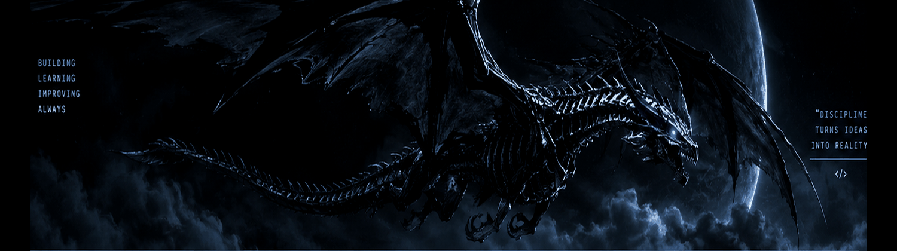

<table>
<tr>
<td width="29%" valign="top">

<h2 align="left">JhonataSkills</h2>

<code>@JhonataSkills</code>

---

**ABOUT ME**

Sou professor de programação para crianças e jovens e estou aprofundando meus estudos em Python e desenvolvimento de jogos.

**INTERESSES**

**LOCATION**

Teresina, PI · Brasil

</td>
<td width="71%" valign="top">

<table>
<tr>
<td>

<h2>Welcome to my Hub</h2>

Um espaço para acompanhar meu aprendizado em programação, tecnologia e criação de jogos.

</td>
</tr>
</table>

<table>
<tr>
<td align="center" width="25%">

**Python**

Estudando

</td>
<td align="center" width="25%">

**Game Dev**

Aprendendo

</td>
<td align="center" width="25%">

**Ensino**

Experiência

</td>
<td align="center" width="25%">

**GitHub**

Começando

</td>
</tr>
</table>

<table>
<tr>
<td>

<h3>GitHub Activity</h3>

</td>
</tr>
</table>

<table>
<tr>
<td width="50%" valign="top">

<h3>TECH STACK</h3>

</td>
<td width="50%" valign="top">

<h3>CURRENT FOCUS</h3>

- Aprimorar minha base em Python
- Aprender criando jogos 2D
- Preparar atividades de programação
- Publicar meus primeiros projetos

</td>
</tr>
</table>

</td>
</tr>
</table>

---

<h3 align="left">Projects</h3>

<table>
<tr>
<td align="center">

**Ainda estou começando**

Não vou listar projetos fictícios. Esta área será preenchida com trabalhos reais conforme eu desenvolver e publicar meus projetos.

 

</td>
</tr>
</table>

LEARNING IN PUBLIC · BUILDING ONE STEP AT A TIME

